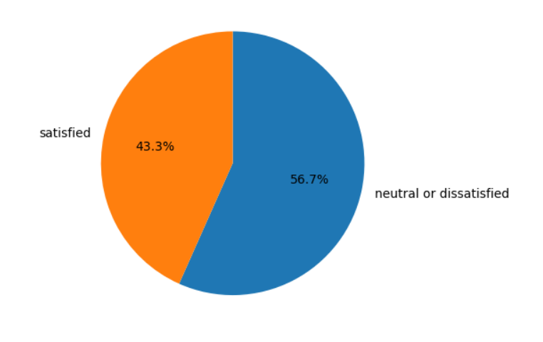
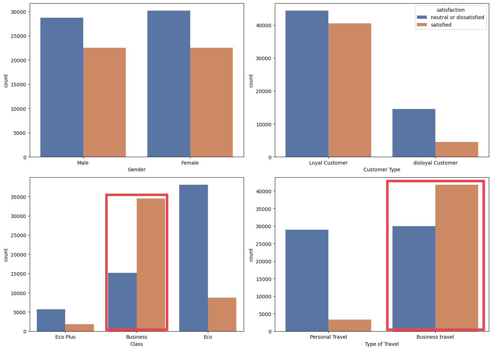
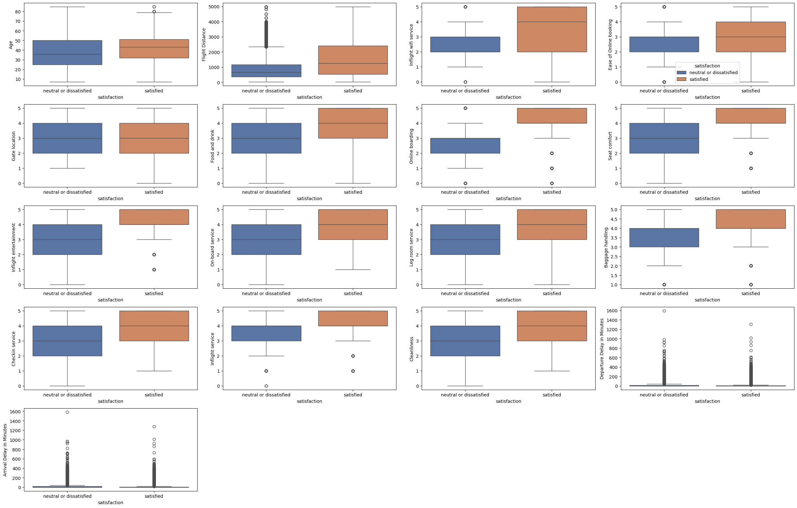
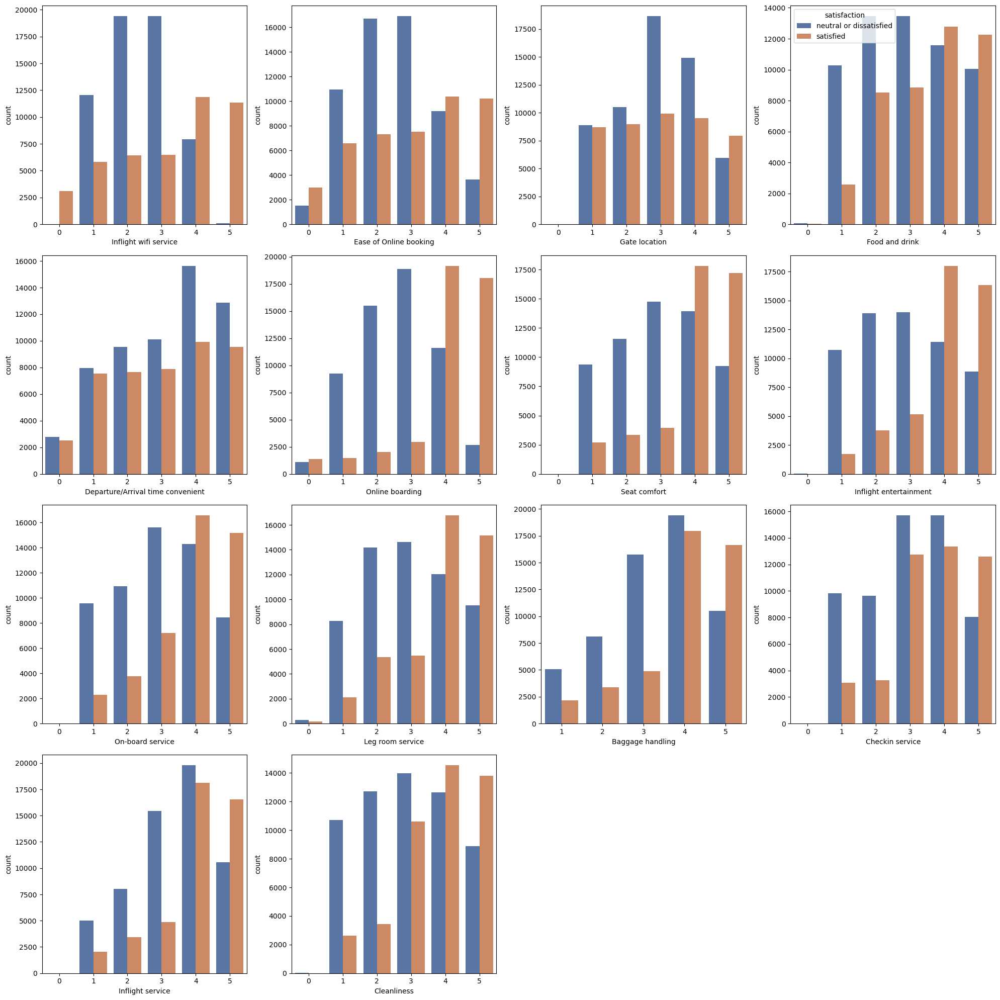
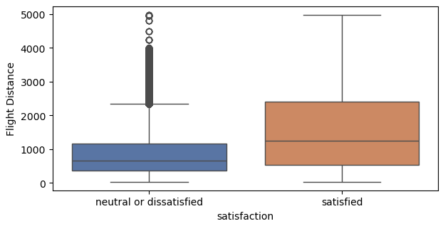

# 항공 승객 만족도 분석
### 무엇부터 개선해야 만족도가 오를까?

Kaggle 항공 승객 만족도 설문 데이터로 **로지스틱 회귀 모델**을 만들고, **오즈비**로 서비스별 영향력을 비교해 **항공사의 서비스 개선 우선순위**를 도출한 개인 프로젝트입니다.

| 항목 | 내용 |
|---|---|
| 기간 | 2026.02 수행 · 2026.10 고도화 |
| 인원 | 1명 (개인 프로젝트) |
| 사용 도구 | Python (pandas, numpy, matplotlib, seaborn, statsmodels, scikit-learn), Jupyter |
| 분석 흐름 | 데이터 탐색(시각화) → 전처리 → 모델 선택 및 베이스라인 학습 → 모델 향상 → 모델 해석 |

---

## 1. 프로젝트 개요



| | |
|---|---|
| **목표** | 한정된 예산으로, 어떤 서비스를 먼저 개선해야 승객 만족률이 가장 많이 오를지 정한다 |
| **문제** | 승객 10명 중 6명은 전체 비행에 만족하지 못했다 (불만족률 56.7%) |
| **질문** | 개선할 서비스는 14개인데 예산은 한정되어 있다. 무엇부터 개선해야 할까? |
| **제안** | 기내 와이파이 → 온라인 탑승 → 체크인 순으로 우선 개선한다 |

## 2. 데이터

- Kaggle 비행기 승객 만족도 설문조사 데이터 (`train.csv`)
- **103,904행 × 24컬럼**

| 구분 | 개수 | 컬럼 |
|---|---:|---|
| 승객 정보 | 5 | Gender, Customer Type, Age, Type of Travel, Class |
| 서비스 평가 (0~5점) | 14 | Inflight wifi service, Departure/Arrival time convenient, Ease of Online booking, Gate location, Food and drink, Online boarding, Seat comfort, Inflight entertainment, On-board service, Leg room service, Baggage handling, Checkin service, Inflight service, Cleanliness |
| 운항 정보 | 3 | Flight Distance, Departure Delay in Minutes, Arrival Delay in Minutes |
| 기타 | 2 | id, satisfaction (satisfied / neutral or dissatisfied) |

## 3. 데이터 탐색 (시각화)

### ① 범주형 변수와 만족도



- 성별과 충성 고객 여부에 따른 만족도는 차이가 없어 보임
- **비즈니스 클래스**가 이코노미 클래스에 비해 만족하는 경우가 많음
- **비즈니스 여행**이 개인 여행에 비해 만족하는 경우가 많음

### ② 수치형 변수 박스플롯



- 나이와 입구 위치(Gate location), 지연 시각은 만족 여부와 큰 상관이 없어 보임
- 지연 시각의 경우 이상치가 다수 존재

### ③ 서비스 점수별 만족도



- **대부분의 변수가 4점을 기준으로 만족도 차이를 보임**
- → 이후 모델 성능 향상 단계에서 4점 기준 구간화 파생변수로 반영

## 4. 데이터 전처리

### ① id 컬럼 제거
- 단순 식별자로서 만족도와 관계없음

### ② 결측치 처리: 회귀 대치
- 결측치는 `Arrival Delay in Minutes`에만 **0.298%** 존재
- 출발 지연과 도착 지연의 상관이 **0.965**로 높아, 적은 결측치지만 제거하지 않고 회귀 대치 수행

| 결측 확인 | → | 상관 확인 | → | OLS 회귀 | → | 대치 |
|---|---|---|---|---|---|---|
| Arrival Delay 0.298% | | 출발 ↔ 도착 지연 0.965 | | R² 0.932 | | 결측 0% |

```
Arrival Delay = 0.7224 + 0.9802 × Departure Delay   (결측 없는 103,594건으로 학습)
```

### ③ 이상치 처리: Flight Distance



- 이상치가 분산을 과도하게 증가시켜 분석 및 모델링 정확도를 감소시킴 → **IQR 기준 상한 및 하한 값으로 대치**

```python
IQR = Q3 - Q1
df_train["Flight Distance"] = df_train["Flight Distance"].clip(lower=Q1 - 1.5*IQR, upper=Q3 + 1.5*IQR)
```

## 5. 모델 선택: 로지스틱 회귀

**왜 로지스틱 회귀인가?**
목적은 만족 여부를 맞히는 것보다, 어떤 서비스가 만족에 얼마나 영향을 주는지 해석하는 것 → 해석력이 좋은 모델이 필요

1. **계수로 영향력을 볼 수 있음**: 회귀 모델이라 각 변수의 계수(coef) 부호와 크기로, 만족에 주는 영향의 방향과 크기를 확인할 수 있음
2. **오즈비로 효과를 해석할 수 있음**: 계수를 오즈비로 바꾸면, 다른 조건이 같을 때 변수가 변하면 만족 오즈가 몇 배가 되는지 알 수 있음

**로지스틱 회귀 수식**

$$\log\left(\frac{p}{1-p}\right) = \beta_0 + \beta_1x_1 + \cdots + \beta_kx_k$$

$$p = \frac{1}{1 + e^{-(\beta_0 + \beta_1x_1 + \cdots + \beta_kx_k)}}$$

$$\text{오즈비} = e^{\beta_i}$$

- **오즈(Odds)**: 만족할 확률 ÷ 만족하지 않을 확률 = p / (1 − p)
- **오즈비(Odds Ratio)**: 다른 조건이 같을 때 변수가 변하면 오즈가 몇 배가 되는지 (1보다 크면 만족 쪽, 작으면 불만족 쪽)
- p: 만족할 확률, βᵢ: 변수 xᵢ의 계수

## 6. 베이스라인 학습 결과

- 학습 80% / 검증 20% (stratify), 범주형 변수 더미화, 서비스 점수는 그대로 사용 (statsmodels Logit)
- **검증 정확도 87.65% · AUC 0.928**

서비스 변수 계수 (`model_base.summary()`, 계수 큰 순)

| 변수 | coef | P>\|z\| |
|---|---:|---:|
| **Online boarding** | **0.6074** | 0.000 |
| **Inflight wifi service** | **0.3988** | 0.000 |
| Checkin service | 0.3258 | 0.000 |
| On-board service | 0.2946 | 0.000 |
| Leg room service | 0.2555 | 0.000 |
| Cleanliness | 0.2227 | 0.000 |
| Baggage handling | 0.1429 | 0.000 |
| Inflight service | 0.1200 | 0.000 |
| Seat comfort | 0.0709 | 0.000 |
| Inflight entertainment | 0.0571 | 0.000 |
| Gate location | 0.0172 | 0.093 |
| Food and drink | -0.0237 | 0.048 |
| Departure/Arrival time convenient | -0.1195 | 0.000 |
| Ease of Online booking | -0.1347 | 0.000 |

### 베이스라인 결과 해석
- **영향 큼**: wifi service, online boarding, checkin service, class
- **영향 없어 보임**: age, food and drink, gate location
- **해석적 측면의 문제점**: 식음료 계수 -0.0237 → 점수가 1점 오를 때 만족 오즈가 약 2.3% 감소한다는 결과가 나옴. 시각화에서는 식음료 점수가 높을수록 만족 승객이 많았음
- 영향력은 어느 정도 설명되지만, 그 크기는 데이터의 특성을 잘 설명하지 못함 → **모델 성능 향상 필요**

## 7. 모델 성능 향상시키기

### ① 다중공선성 확인 (VIF)

| 변수 | VIF |
|---|---:|
| **Arrival Delay in Minutes** | **14.94** |
| Departure Delay in Minutes | 14.93 |
| Inflight entertainment | 3.89 |
| Cleanliness | 2.89 |

- 출발 · 도착 지연시간이 공선성을 지님 (VIF > 10) → 변수 해석이 어려워 도착 지연시간 삭제

### ② 변수 구간화 (파생변수)
- 특정 구간 전후로 만족도 차이가 많이 남 → 이를 모델에 반영하기 위해 특정 구간을 중심으로 파생변수 생성

| 구간 | 적용 변수 |
|---|---|
| 0~3 / 4~5 | Inflight wifi service, Ease of Online booking, Online boarding, Seat comfort, Inflight entertainment, On-board service, Baggage handling, Inflight service, Departure/Arrival time convenient |
| 0~1 / 2~3 / 4~5 | Food and drink, Leg room service, Checkin service, Cleanliness |

### 개선된 점

| 모델 | 정확도 | AUC |
|---|---:|---:|
| 베이스라인 | 87.65% | 0.928 |
| **개선 모델** | **89.28% (+1.63%p)** | **0.943 (+0.015)** |

## 8. 향상된 모델 결과 해석

개선 모델의 오즈비 (importance 상위 10개, 오즈비 큰 순, `_good` = 해당 서비스 4점 이상)

| 변수 | odds ratio | 95% CI | p-value |
|---|---:|---:|---:|
| **Inflight wifi service_good** | **5.726** | 5.336 ~ 6.144 | 0.000 |
| **Online boarding_good** | **4.875** | 4.604 ~ 5.163 | 0.000 |
| **Checkin service_good** | **2.548** | 2.358 ~ 2.752 | 2.38e-124 |
| Leg room service_good | 2.220 | 2.044 ~ 2.410 | 3.12e-80 |
| On-board service_good | 1.718 | 1.621 ~ 1.820 | 8.18e-75 |
| Seat comfort_good | 1.701 | 1.595 ~ 1.813 | 3.12e-59 |
| Class_Eco | 0.417 | 0.392 ~ 0.443 | 5.65e-173 |
| Class_Eco Plus | 0.357 | 0.323 ~ 0.394 | 1.67e-91 |
| Customer Type_disloyal Customer | 0.120 | 0.112 ~ 0.129 | 0.000 |
| Type of Travel_Personal Travel | 0.069 | 0.064 ~ 0.074 | 0.000 |

- **서비스**: 4점 이상이면 만족 오즈 증가. 와이파이(5.726), 온라인 탑승(4.875), 체크인(2.548) 순
- **승객 특성**: 개인 여행(0.069), 비충성 고객(0.120), 이코노미(0.417)는 만족 오즈가 크게 낮음

## 9. 결론: 기내 와이파이 → 온라인 탑승 → 체크인 순으로 개선

### 오즈비 기준 개선 우선순위

| 순위 | 효과가 확실한 것 | 오즈비 | | 순위 | 그 후 개선하면 긍정적인 것 | 오즈비 |
|---|---|---:|---|---|---|---:|
| 1 | 기내 와이파이 | 5.726 | | 4 | 다리 공간 확보 | 2.220 |
| 2 | 온라인 탑승 확인 | 4.875 | | 5 | 기내 승무원 서비스 | 1.718 |
| 3 | 공항 내 체크인 | 2.548 | | 6 | 좌석 편안함 | 1.701 |

- **개선 우선순위에서 제외**: 식음료 · 온라인 예약 · 기내 엔터테인먼트. 통계적으로 유의하지 않거나 오즈비가 1에 가까워 만족도에 영향이 거의 없음

### 못 바꾸지만 큰 영향을 미치는 것

| 요인 | 비교 | 오즈비 |
|---|---|---:|
| 여행 목적 | 개인 여행 (vs 비즈니스 여행) | 0.069 |
| 고객 충성도 | 비충성 고객 (vs 충성 고객) | 0.120 |
| 좌석 등급 | 이코노미 (vs 비즈니스) | 0.417 |

> **최종 제안**: 한정된 예산은 기내 와이파이와 온라인 탑승 확인 시스템을 4점 이상 수준으로 끌어올리는 데 먼저 쓰고, 이후 체크인 · 다리 공간 순으로 개선한다.

---

## 파일 구성

```
airline_analysis
├── airline.ipynb                         # EDA → 전처리 → 로지스틱 회귀 → 모델 향상 → 오즈비 해석
├── images/                               # README 이미지
│   ├── 01_satisfaction_pie.png
│   ├── 02_categorical_countplot.png
│   ├── 03_numeric_boxplot.png
│   ├── 04_service_score_countplot.png
│   └── 05_flight_distance_boxplot.png
└── README.md
```

## 실행 방법

1. 패키지 설치
   ```bash
   pip install pandas numpy matplotlib seaborn statsmodels scikit-learn
   ```
2. Kaggle의 항공 승객 만족도 데이터에서 `train.csv`를 내려받고, 노트북의 `path`를 내 파일 경로로 바꿉니다.
3. `airline.ipynb`를 실행합니다.
